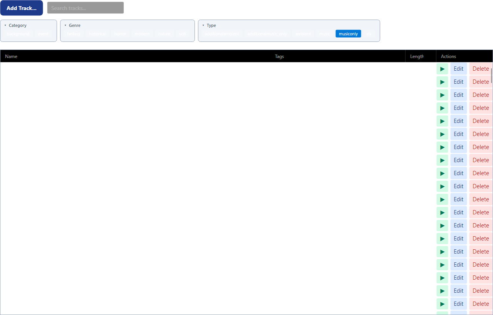
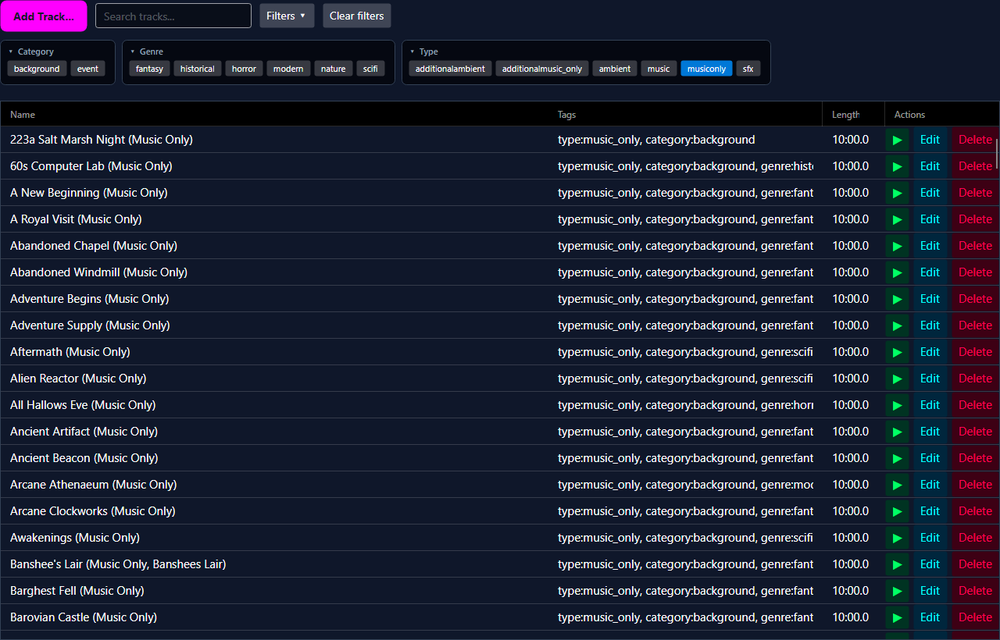

# gmsb-theme-sci-fi

Sci-Fi theme pack for [Game Master Sound Board](https://github.com/DevinSanders/game-master-soundboard).

Two selectable palettes for science-fiction RPG sessions. Each appears as its own entry in the host's theme dropdown.

| Palette          | Vibe                                                        | Primary accent           | Secondary accent              |
|------------------|-------------------------------------------------------------|---------------------------|--------------------------------|
| Starship Command | A sterile, brightly lit federation bridge / corporate lab.  | Navy blue #1E3A8A         | Warning-hazard orange #EA580C |
| Neon Cyberpunk   | A rainy, neon-lit alleyway at midnight.                     | Neon magenta #FF00FF      | Electric cyan #00FFFF         |

## Preview

### Starship Command

Telemetry & clean-room — crisp high-contrast whites and cool telemetry grays (#F1F5F9), navy-blue primary actions, hazard-orange status warnings. For Starfinder / Traveller / Star Trek Adventures.



### Neon Cyberpunk

The grid — pure obsidian and slate-950 surfaces make UI elements pop dramatically. Blinding neon magenta primary, electric cyan secondary, laser-green success indicators. For Cyberpunk RED / Shadowrun / Blade Runner.



## Install

**Paid plugin.** The source is open here for reference, but the pre-built
binary is distributed pay-what-you-want on itch.io:

**→ https://dsand64.itch.io/gmsb-theme-sci-fi**

Download the `.zip` from that page and drop it onto **Settings → Plugin
Manager** in Game Master Sound Board. Themes activate live — no restart needed; pick the palette under **Settings → Appearance → Theme**.

## Build

```powershell
dotnet build src/SciFiThemePlugin.csproj
pwsh scripts/package.ps1
# → dist/github.DevinSanders-theme.sci-fi-1.0.0.zip
```

## Plugin manifest

| Field     | Value                       |
|-----------|-----------------------------|
| publisher | `github.DevinSanders`       |
| id        | `theme.sci-fi`              |
| entryDll  | `SciFiThemePlugin.dll`      |
| isTheme   | `true`                      |

## License

Released under the [MIT License](LICENSE). Original colour design for this pack.
